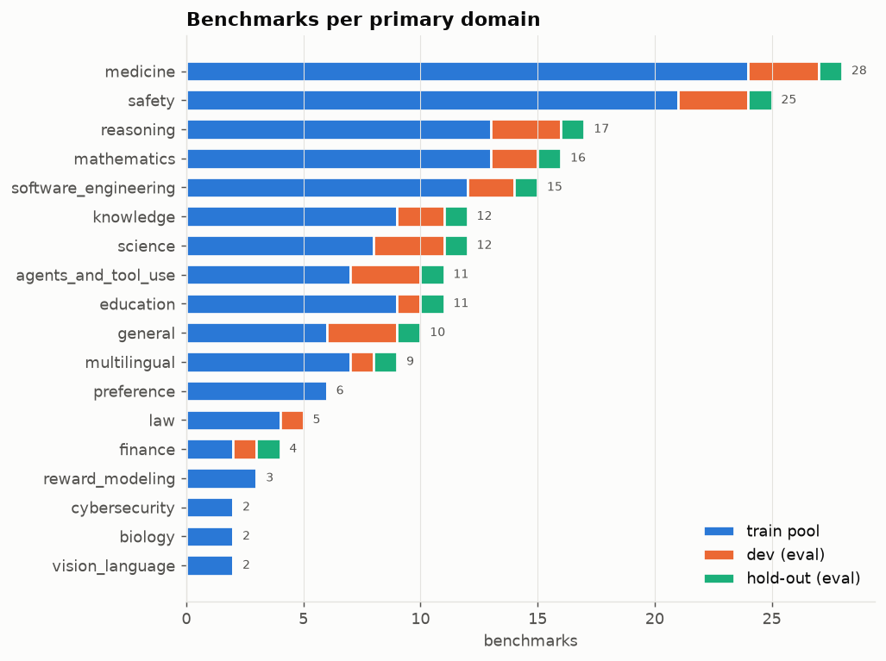
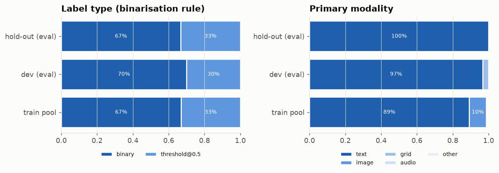
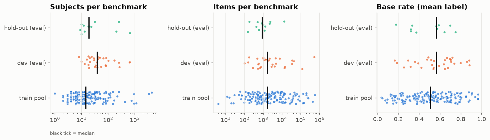
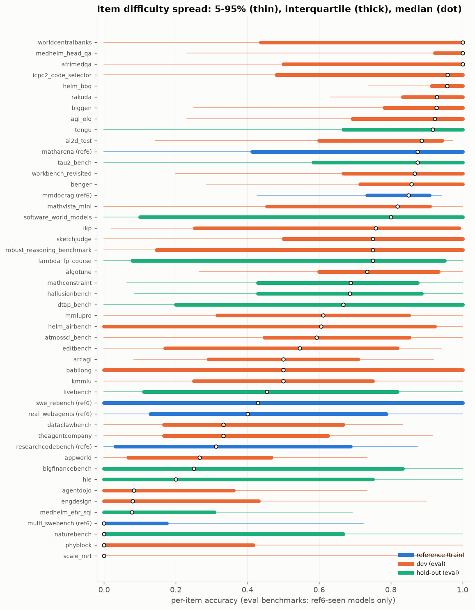
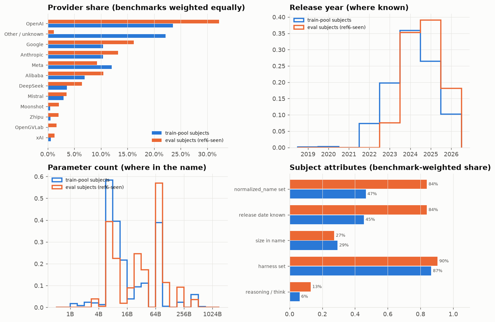
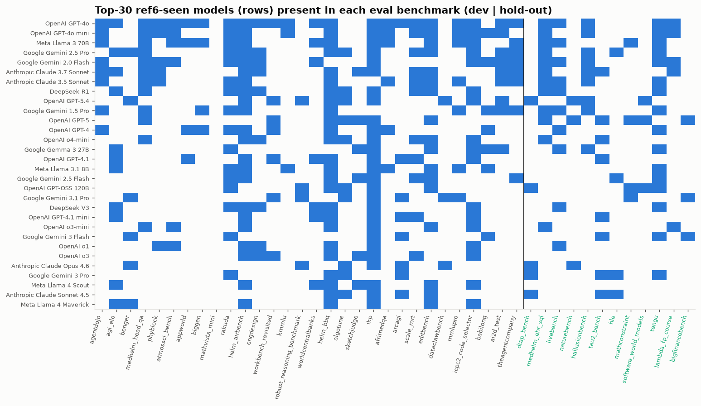

# Split quality report: `configs/split_seen`

Generated by `scripts/split_report.py`. Data: `/fs/clip-scratch/mgor/measurement-db` (revision 54074453).

## Sanity checks

| check | result | detail |
|---|---|---|
| Hold-out benchmarks absent from the dev universe (never trained on during dev) | PASS | 0 overlap |
| Dev folds are disjoint | PASS | 30 benchmarks in 5 folds |
| Reference benchmarks are training-only | PASS |  |
| Eval benchmarks share <= 1% of items with any other benchmark | PASS | max 0.71% |
| >= 6 distinct ref6 models with >= 80-item pairs per eval benchmark | PASS | min 6 |
| Eval base rates within [0.05, 0.95] | PASS | range 0.17-0.88 |
| Every benchmark has a binarisation rule (not excluded) | PASS |  |
| Eval domain cap (<= 4 per primary domain) | PASS | max 4 |
| Replay: every evaluated pair has >= 80 distinct items | PASS | 344 pairs |
| Replay: every evaluated pair reveals 31 labels | PASS |  |

## Composition

| group           |   benchmarks |   domains |   subjects |   eligible pairs |   ref6-seen eligible pairs |   responses (M, uncapped) |   median base rate |
|:----------------|-------------:|----------:|-----------:|-----------------:|---------------------------:|--------------------------:|-------------------:|
| train pool      |          166 |        34 |      16375 |            13643 |                       2770 |                      67.1 |              0.508 |
| dev (eval)      |           30 |        15 |       2935 |             2201 |                        798 |                       8   |              0.568 |
| hold-out (eval) |           12 |        12 |       1247 |             1209 |                        221 |                       0.8 |              0.568 |

Eval subjects (ref6-seen, in eval benchmarks): 1496 subject rows, 123 distinct models. Train-pool subjects: 16375 rows, 3906 distinct models.

Models present in the most eval benchmarks: OpenAI GPT-4o (28), OpenAI GPT-4o mini (20), Meta Llama 3 70B (19), Google Gemini 2.5 Pro (18), Google Gemini 2.0 Flash (18), Anthropic Claude 3.7 Sonnet (17), Anthropic Claude 3.5 Sonnet (16), DeepSeek R1 (14), OpenAI GPT-5.4 (14), Google Gemini 1.5 Pro (14), OpenAI GPT-5 (13), OpenAI GPT-4 (12)

## Figures

## Eval benchmarks

| benchmark                  | group   | dom1                        | rule          |   n_subj |   seen_eval_identities |   seen_eval_pairs |   n_items |   base_rate |   label_sd |   item_sd |
|:---------------------------|:--------|:----------------------------|:--------------|---------:|-----------------------:|------------------:|----------:|------------:|-----------:|----------:|
| agentdojo                  | dev     | agents_and_tool_use         | binary        |       29 |                      8 |                18 |      1081 |       0.361 |      0.106 |     0.231 |
| appworld                   | dev     | agents_and_tool_use         | binary        |       18 |                      6 |                15 |       585 |       0.253 |      0.211 |     0.211 |
| workbench_revisited        | dev     | agents_and_tool_use         | binary        |       24 |                     14 |                15 |       690 |       0.739 |      0.180 |     0.236 |
| sketchjudge                | dev     | education                   | binary        |       38 |                      8 |                20 |      4053 |       0.646 |      0.072 |     0.302 |
| dataclawbench              | dev     | finance                     | threshold@0.5 |        8 |                      6 |                 6 |       492 |       0.390 |      0.127 |     0.296 |
| agi_elo                    | dev     | general                     | binary        |       20 |                     13 |                13 |     13953 |       0.704 |      0.203 |     0.231 |
| biggen                     | dev     | general                     | threshold@0.5 |      103 |                      6 |                11 |      4589 |       0.719 |      0.193 |     0.255 |
| kmmlu                      | dev     | general                     | binary        |       30 |                      8 |                 8 |     35015 |       0.537 |      0.152 |     0.268 |
| ikp                        | dev     | knowledge                   | binary        |      170 |                     80 |                83 |      1400 |       0.592 |      0.161 |     0.359 |
| mmlupro                    | dev     | knowledge                   | binary        |       48 |                     10 |                20 |     14226 |       0.544 |      0.173 |     0.324 |
| benger                     | dev     | law                         | binary        |       41 |                      7 |                14 |       760 |       0.799 |      0.221 |     0.255 |
| mathvista_mini             | dev     | mathematics                 | binary        |      263 |                      9 |                11 |      1000 |       0.514 |      0.157 |     0.252 |
| robust_reasoning_benchmark | dev     | mathematics                 | binary        |       31 |                      6 |                15 |      4895 |       0.421 |      0.301 |     0.434 |
| afrimedqa                  | dev     | medicine                    | binary        |       34 |                      8 |                 9 |     42494 |       0.676 |      0.101 |     0.386 |
| icpc2_code_selector        | dev     | medicine                    | binary        |       39 |                     23 |                24 |      2175 |       0.668 |      0.133 |     0.345 |
| medhelm_head_qa            | dev     | medicine                    | binary        |       13 |                     13 |                13 |      1000 |       0.882 |      0.059 |     0.235 |
| rakuda                     | dev     | multilingual                | threshold@0.5 |      647 |                     15 |                21 |       280 |       0.858 |      0.256 |     0.200 |
| worldcentralbanks          | dev     | natural_language_processing | binary        |       10 |                      8 |                 8 |    119925 |       0.636 |      0.212 |     0.443 |
| arcagi                     | dev     | reasoning                   | threshold@0.5 |       80 |                     18 |                38 |       526 |       0.538 |      0.306 |     0.259 |
| babilong                   | dev     | reasoning                   | binary        |       83 |                     13 |                24 |    526202 |       0.489 |      0.215 |     0.417 |
| phyblock                   | dev     | reasoning                   | threshold@0.5 |       21 |                     15 |                17 |      1362 |       0.295 |      0.152 |     0.304 |
| helm_airbench              | dev     | safety                      | threshold@0.5 |       66 |                     35 |                39 |      7723 |       0.647 |      0.158 |     0.387 |
| helm_bbq                   | dev     | safety                      | binary        |       81 |                     40 |                46 |      2000 |       0.883 |      0.121 |     0.188 |
| scale_mrt                  | dev     | safety                      | threshold@0.5 |      633 |                     13 |               165 |     34698 |       0.167 |      0.262 |     0.317 |
| ai2d_test                  | dev     | science                     | binary        |      254 |                     21 |                35 |      3088 |       0.695 |      0.152 |     0.252 |
| atmossci_bench             | dev     | science                     | threshold@0.5 |       54 |                     14 |                37 |      2802 |       0.526 |      0.208 |     0.310 |
| engdesign                  | dev     | science                     | binary        |       16 |                      9 |                12 |       101 |       0.188 |      0.100 |     0.308 |
| algotune                   | dev     | software_engineering        | binary        |       18 |                     15 |                15 |       154 |       0.707 |      0.116 |     0.240 |
| editbench                  | dev     | software_engineering        | binary        |       44 |                     31 |                34 |       540 |       0.476 |      0.086 |     0.331 |
| theagentcompany            | dev     | tool_use                    | threshold@0.5 |       19 |                     11 |                12 |       175 |       0.316 |      0.242 |     0.254 |
| tau2_bench                 | holdout | agents_and_tool_use         | binary        |       31 |                     11 |                24 |      2388 |       0.751 |      0.137 |     0.291 |
| lambda_fp_course           | holdout | education                   | threshold@0.5 |        9 |                      8 |                 8 |       152 |       0.588 |      0.098 |     0.402 |
| bigfinancebench            | holdout | finance                     | threshold@0.5 |       10 |                      6 |                 6 |       600 |       0.373 |      0.114 |     0.374 |
| livebench                  | holdout | general                     | threshold@0.5 |      200 |                     26 |                45 |      1286 |       0.322 |      0.177 |     0.279 |
| hle                        | holdout | knowledge                   | binary        |       20 |                      8 |                 9 |      2249 |       0.322 |      0.152 |     0.412 |
| mathconstraint             | holdout | mathematics                 | binary        |       12 |                      8 |                 8 |       504 |       0.644 |      0.153 |     0.293 |
| medhelm_ehr_sql            | holdout | medicine                    | binary        |       13 |                     13 |                13 |      1000 |       0.179 |      0.083 |     0.246 |
| tengu                      | holdout | multilingual                | threshold@0.5 |      647 |                     32 |                42 |       840 |       0.697 |      0.158 |     0.334 |
| hallusionbench             | holdout | reasoning                   | binary        |      254 |                     21 |                35 |      1205 |       0.565 |      0.114 |     0.238 |
| dtap_bench                 | holdout | safety                      | binary        |       10 |                      7 |                10 |     13392 |       0.573 |      0.077 |     0.385 |
| naturebench                | holdout | science                     | binary        |       23 |                      8 |                11 |       181 |       0.334 |      0.124 |     0.361 |
| software_world_models      | holdout | software_engineering        | binary        |       18 |                     10 |                10 |       434 |       0.572 |      0.060 |     0.409 |
